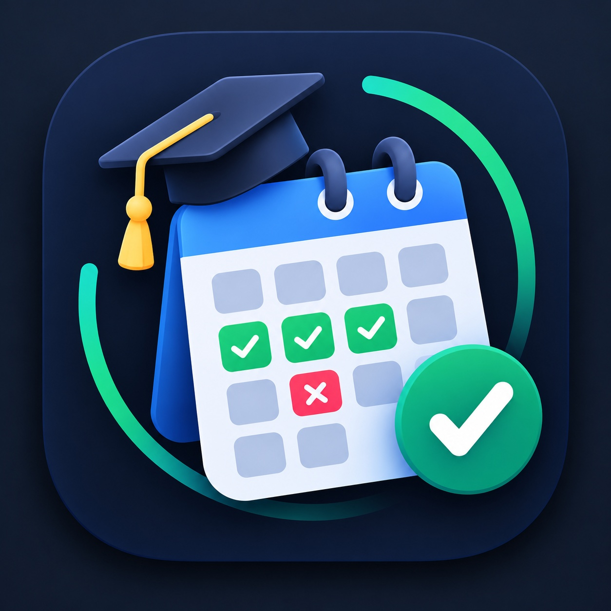

# Attendance Tracker for Android

  

**Attendance Tracker** is an Android app for recording class attendance and checking whether you can safely miss upcoming classes or need to attend more classes to reach your target.

> This GitHub repository distributes the **compiled Android APK and documentation only**. The application source code is not published here.

## Download

**[Download the latest Android APK](https://github.com/YOUR-GITHUB-USERNAME/AttendanceTracker/releases/latest/download/AttendanceTracker.apk)**

Or open the [Releases page](https://github.com/YOUR-GITHUB-USERNAME/AttendanceTracker/releases/latest) and download `AttendanceTracker.apk` from the latest release assets.

> Replace `YOUR-GITHUB-USERNAME` in the two links above with your GitHub username before publishing this README.

## Features

- Calculate current attendance percentage against a configurable target.
- Adjust total, present, and absent class counts.
- Use attendance target presets or enter a custom target.
- View the upcoming attendance trajectory and estimated classes to attend or safe bunks.
- Mark calendar days as Present, Absent, or Holiday.
- Add notes to help organize attendance records.
- Store records locally on the device between normal app launches.
- Use the app's custom calendar and graduation-cap icon.

## Install on Android

1. Download `AttendanceTracker.apk` from the latest release.
2. Open the downloaded APK on your Android device.
3. If Android asks, allow your browser or file manager to install apps from that source.
4. Review the installation prompt and install the app.
5. Open Attendance Tracker and test it with your own records.

Android may display a warning for apps installed outside Google Play. Install APKs only when you trust the release and its publisher.

See [INSTALLATION.md](INSTALLATION.md) for more detailed guidance.

## Data and privacy

Attendance records are intended to be stored locally on the device. The app does not offer a user account or cloud synchronization in this release. Clearing the app's storage or uninstalling the app may delete locally stored records.

Read [PRIVACY.md](PRIVACY.md) for the current release's privacy summary.

## Updates and support

Check the [Releases page](https://github.com/YOUR-GITHUB-USERNAME/AttendanceTracker/releases) for new versions and release notes. For an issue with a particular release, open a GitHub Issue and include your Android version, app version, and steps to reproduce the problem. Do not post personal attendance records or other sensitive information.

## Repository contents

This repository intentionally contains public-facing documentation and the app icon only. It does not contain the HTML file, Android Studio project, signing key, or other source/build files. Compiled APKs are attached to GitHub Releases rather than committed to the repository's file list.
